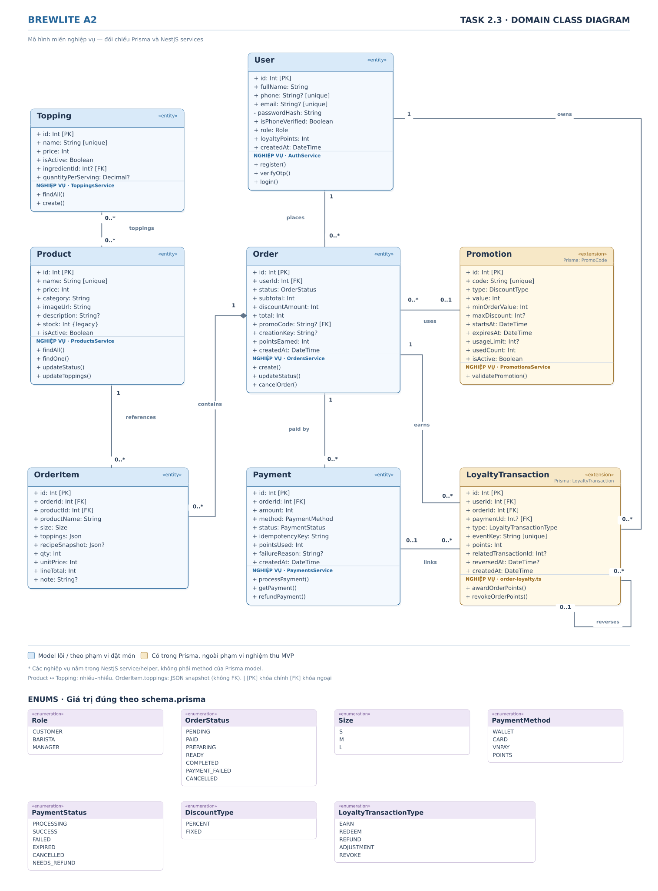

# Task 2.3 — Domain Class Diagram | BrewLite A2

**File chỉnh sửa:** [`class-domain.puml`](./class-domain.puml) · **Hình SVG:** [`class-domain.svg`](./class-domain.svg)

Sơ đồ có 8 lớp (7 lớp bắt buộc và `Topping`), 7 enum từ Prisma, thuộc tính nghiệp vụ, quan hệ với bội số và các thao tác được đối chiếu với service/helper thực tế. Định dạng và mức chi tiết tham khảo sơ đồ nhóm khác, nhưng **mọi trường dữ liệu và hành vi đều theo BrewLite A2**, không sao chép mô hình của nhóm kia.

## 1. Đối chiếu 8 lớp với source

| Lớp trong đề | Model thật | Ý nghĩa | File kiểm chứng |
|---|---|---|---|
| `User` | `User` | Người dùng, OTP, vai trò, số dư điểm | `prisma/schema.prisma`, `auth/auth.service.ts` |
| `Product` | `Product` | Món, giá, loại món, trạng thái bán, cấu hình topping | `prisma/schema.prisma`, `products/products.service.ts` |
| `Topping` | `Topping` | Topping có giá và trạng thái bán, liên kết nhiều–nhiều với Product | `prisma/schema.prisma`, `products/toppings.service.ts` |
| `Order` | `Order` | Đơn, tổng tiền, trạng thái, mã khuyến mãi | `prisma/schema.prisma`, `orders/orders.service.ts` |
| `OrderItem` | `OrderItem` | Dòng món, size, topping snapshot, qty, đơn giá | `prisma/schema.prisma`, `common/pricing/pricing.service.ts` |
| `Payment` | `Payment` | Thanh toán, phương thức, trạng thái và chống trùng | `prisma/schema.prisma`, `payments/payments.service.ts` |
| `Promotion` | **`PromoCode`** | Mã ưu đãi với điều kiện sử dụng | `prisma/schema.prisma`, `promotions/promotions.service.ts` |
| `LoyaltyTransaction` | `LoyaltyTransaction` | Ghi sổ điểm, liên kết đơn/thanh toán và thu hồi | `prisma/schema.prisma`, `orders/order-loyalty.ts` |

> Tất cả đường dẫn trên tính từ `apps/api/`, ví dụ: `apps/api/src/orders/orders.service.ts`; file schema là `apps/api/prisma/schema.prisma`.

## 2. Bảng quan hệ và multiplicity

| Quan hệ | Bội số | Cơ sở |
|---|---|---|
| User — Order | `1` — `0..*` | Mỗi Order có đúng 1 User |
| User — LoyaltyTransaction | `1` — `0..*` | Mỗi bản ghi điểm có đúng 1 User |
| Product — Topping | `0..*` — `0..*` | Quan hệ nhiều–nhiều trong Prisma: `Product.toppings` và `Topping.products` |
| Product — OrderItem | `1` — `0..*` | Mỗi dòng món tham chiếu 1 Product |
| Order — OrderItem (composition) | `1` — `0..*` | Prisma cho phép 0 dòng; **API tạo đơn yêu cầu 1–30 dòng** |
| Order — Payment | `1` — `0..*` | Một đơn có thể có nhiều lượt thanh toán |
| Order — Promotion | `0..*` — `0..1` | Order.promoCode tùy chọn, trỏ PromoCode.code |
| Order — LoyaltyTransaction | `1` — `0..*` | Mỗi giao dịch điểm gắn với 1 đơn |
| Payment — LoyaltyTransaction | `0..1` — `0..*` | paymentId là nullable |
| LoyaltyTransaction — LoyaltyTransaction | `0..1` — `0..*` | relatedTransactionId / childTransactions: thu hồi, đảo giao dịch điểm |

**Lưu ý:** `Product` và `Topping` có quan hệ nhiều–nhiều thực sự. Riêng `OrderItem.toppings` và `recipeSnapshot` là JSON snapshot, **không có FK trực tiếp từ OrderItem đến Topping**. `Topping.ingredientId` trỏ đến `Ingredient` có thật, nhưng sơ đồ mức domain của Task 2.3 không vẽ cả mô-đun kho để tránh rối. `Product.category` là String, không có lớp `Category` trong schema. `Product.stock` là trường tồn kho thành phẩm cũ (legacy), **không phải** tồn kho nguyên liệu hiện đại.

## 3. Enum trạng thái và phân loại

| Enum | Giá trị đúng trong Prisma |
|---|---|
| `Role` | `CUSTOMER`, `BARISTA`, `MANAGER` |
| `OrderStatus` | `PENDING`, `PAID`, `PREPARING`, `READY`, `COMPLETED`, `PAYMENT_FAILED`, `CANCELLED` |
| `Size` | `S`, `M`, `L` |
| `PaymentMethod` | `WALLET`, `CARD`, `VNPAY`, `POINTS` |
| `PaymentStatus` | `PROCESSING`, `SUCCESS`, `FAILED`, `EXPIRED`, `CANCELLED`, `NEEDS_REFUND` |
| `DiscountType` | `PERCENT`, `FIXED` |
| `LoyaltyTransactionType` | `EARN`, `REDEEM`, `REFUND`, `ADJUSTMENT`, `REVOKE` |

## 4. Các thao tác nghiệp vụ hiển thị trên sơ đồ

Giống bố cục sơ đồ mẫu, các ô lớp có **ngăn thao tác nghiệp vụ**. Cần hiểu chính xác rằng: **Prisma model của dự án không khai báo các phương thức này**; đó là những method/function **được cài ở NestJS service/helper**, hiển thị để truy vết nghiệp vụ domain. Nếu giảng viên yêu cầu class diagram chỉ có thuộc tính và quan hệ, nhóm có thể bỏ ngăn này trong PlantUML.

| Nhóm lớp | Thao tác trên hình | Nguồn thực tế |
|---|---|---|
| User | `register`, `verifyOtp`, `login` | `AuthService` (`auth.service.ts`) |
| Product | `findAll`, `findOne`, `updateStatus`, `updateToppings` | `ProductsService` (`products.service.ts`) |
| Topping | `findAll`, `create` | `ToppingsService` (`products/toppings.service.ts`) |
| Order | `create`, `updateStatus`, `cancelOrder` | `OrdersService` (`orders.service.ts`) |
| OrderItem | Không thêm method giả | `PricingService.calculate` thực hiện định giá line |
| Payment | `processPayment`, `getPayment`, `refundPayment` | `PaymentsService` (`payments.service.ts`) |
| Promotion | `validatePromotion` | `PromotionsService` (`promotions.service.ts`) |
| LoyaltyTransaction | `awardOrderPoints`, `revokeOrderPoints` | Các hàm xuất ra từ `orders/order-loyalty.ts` |

## 5. Phạm vi so với Task 1.1 và Task 1.2

`Promotion` và `LoyaltyTransaction` đều có model trong source, nhưng voucher, điểm thưởng thuộc **phần mở rộng ngoài nghiệm thu MVP** trong `docs/requirements/context-and-scope.md`. Task 2.3 vẫn **bắt buộc mô hình hóa cả hai lớp** theo đề, vì vậy sơ đồ đánh dấu màu khác để tránh nhầm với chức năng chính.

`VNPAY` và `POINTS` xuất hiện trong `PaymentMethod` vì **đây là giá trị enum có thật**. Sự có mặt trong schema **không đồng nghĩa** các kịch bản thanh toán đó thuộc phạm vi MVP hoặc đã vượt qua nghiệm thu giao diện.

## 6. Giới hạn của sơ đồ

Sơ đồ thuộc mức domain, không liệt kê tất cả bảng kỹ thuật (refund, webhook, inventory), nhưng phản ánh **đầy đủ 7 lớp đề yêu cầu, bổ sung Topping có thật trong code và những quan hệ chính giữa chúng**. Các thao tác là tham chiếu tới service, không phải phương thức triển khai ngay trên class Prisma.

**Nguồn dùng để rà soát:** file người dùng gửi `brewlite-a2-main (1).zip` → `apps/api/prisma/schema.prisma` và các service nêu ở trên. Chưa xác minh những commit mới hơn trên GitHub.
