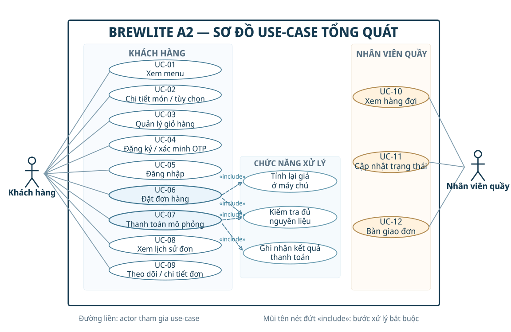

# 3.2. Task 1.2 – Đặc tả yêu cầu SRS rút gọn cho BrewLite A2

**Phiên bản:** 1.0 (dự thảo nghiệm thu)  | **Ngày:** 13/11/2026  | **Nguồn:** `docs/Assignment2-BrewLite.pdf`, `docs/requirements/context-and-scope.md`, đối chiếu source `apps/api` và `apps/web`.

> **Lưu ý:** Đây là đặc tả **mục tiêu phải đạt**, không phải kết quả đã kiểm thử. Giá trị thời gian, tải và mẫu thử trong NFR là ngưỡng đề xuất để nhóm chốt trước nghiệm thu.

## 1. Mục tiêu, phạm vi và quy ước
BrewLite phục vụ **một cửa hàng**, khách nhận hàng **tại quầy**, thanh toán **Ví/Thẻ mô phỏng** trong MVP. Luồng chính: **Menu → Chi tiết & tùy chọn → Giỏ hàng → Đăng nhập → Đặt đơn → Thanh toán → Lịch sử / Theo dõi**. Nhân viên quầy tiếp nhận, pha chế và bàn giao đơn.

**Actor nghiệp vụ:** Khách hàng (Customer), Nhân viên quầy (Barista). Các stakeholder khác không tự động là actor MVP. Thành phần mock-payment nằm trong hệ thống, không mô hình hóa như actor bên ngoài.

**MoSCoW:** **Must** = bắt buộc của MVP; **Should** = nên có nếu đủ nguồn lực; **Could** = cải thiện tùy chọn; **Won’t (this release)** = không nghiệm thu trong MVP A2 dù code kế thừa có thể chứa API liên quan.

**Số lượng:** 30 FR (Must: 25, Should: 3, Could: 2); 15 NFR; 7 nội dung Won’t.

## 2. Yêu cầu chức năng (Functional Requirements – FR)
Mỗi dòng có một điều kiện nghiệm thu đo/kiểm được; mã test gợi ý là `TC-<mã FR>` (ví dụ TC-FR-01).

### Menu
| Mã | Yêu cầu | Ưu tiên | Tiêu chí chấp nhận / ca kiểm thử | Use-case |
|---|---|---|---|---|
| FR-01 | Xem danh sách món đang bán | Must | Với dữ liệu mẫu tối thiểu 10 món, khách chưa đăng nhập xem được tên, ảnh, giá cơ bản và trạng thái có thể đặt; món ngừng bán không xuất hiện trong menu công khai. | UC-01 |
| FR-02 | Trạng thái tải của menu | Must | Kiểm tra 3 trường hợp: đang tải có chỉ báo; danh sách rỗng có thông báo; API lỗi có thông báo và cách thử lại, không để trang trắng. | UC-01 |
| FR-03 | Tìm kiếm và lọc menu | Should | Nhập từ khóa trả món có tên phù hợp; lọc danh mục trả đúng loại; trang 1/2 không trùng và mỗi trang ≤ giới hạn yêu cầu. | UC-01 |

### Chi tiết
| Mã | Yêu cầu | Ưu tiên | Tiêu chí chấp nhận / ca kiểm thử | Use-case |
|---|---|---|---|---|
| FR-04 | Xem chi tiết sản phẩm | Must | Mở một món hợp lệ hiển thị mô tả, giá, size và topping được phép; mã món không tồn tại trả thông báo không tìm thấy/HTTP 404. | UC-02 |
| FR-05 | Chọn size, topping, số lượng | Must | Khách chọn size S/M/L, tối đa 3 topping không trùng, số lượng 1–20 mỗi dòng; lựa chọn vượt giới hạn bị chặn trước hoặc khi gửi yêu cầu. | UC-02 |
| FR-06 | Hiển thị tạm tính theo lựa chọn | Must | Đổi size, topping hoặc số lượng thì tạm tính cập nhật; với 5 tổ hợp thử, giao diện khớp công thức giá đã cấu hình. | UC-02 |

### Giỏ hàng
| Mã | Yêu cầu | Ưu tiên | Tiêu chí chấp nhận / ca kiểm thử | Use-case |
|---|---|---|---|---|
| FR-07 | Thêm sản phẩm vào giỏ | Must | Thêm món hợp lệ lưu đủ productId, size, toppingIds, quantity; giao diện giỏ hiển thị đúng lựa chọn vừa thêm. | UC-03 |
| FR-08 | Sửa số lượng và xóa món | Must | Tăng/giảm số lượng trong giới hạn làm thay đổi giỏ; xóa món loại món khỏi danh sách; số lượng 0/âm không được chấp nhận. | UC-03 |
| FR-09 | Tổng tiền giỏ trước đặt | Must | Tổng tiền hiển thị = tổng thành tiền các dòng theo lựa chọn; giỏ rỗng không được gửi yêu cầu tạo đơn. | UC-03 |
| FR-10 | Giữ giỏ sau tải lại trang | Could | Tải lại trình duyệt cùng phiên vẫn giữ các dòng giỏ hợp lệ và tính lại tiền; dữ liệu không còn hợp lệ được yêu cầu cập nhật. | UC-03 |

### Xác thực
| Mã | Yêu cầu | Ưu tiên | Tiêu chí chấp nhận / ca kiểm thử | Use-case |
|---|---|---|---|---|
| FR-11 | Đăng ký và xác minh OTP | Must | Đăng ký hợp lệ tạo tài khoản chờ xác minh; OTP hợp lệ trong 300 giây xác minh được; OTP sai hoặc hết hạn bị từ chối; chưa xác minh không đăng nhập để đặt hàng. | UC-04 |
| FR-12 | Đăng nhập tài khoản | Must | Thông tin đăng nhập đúng trả phiên/token hợp lệ; sai mật khẩu trả lỗi, không tạo phiên; khách chưa đăng nhập bị chuyển sang xác thực trước khi đặt. | UC-05 |
| FR-13 | Phân quyền truy cập đơn | Must | Khách A không xem được đơn của khách B; khách không gọi được API hàng đợi/cập nhật trạng thái dành cho BARISTA; API trả 401 hoặc 403 tương ứng. | UC-05 / UC-09 |
| FR-14 | Gửi lại OTP | Should | Chỉ cho gửi lại sau 60 giây; mã mới vô hiệu mã trước; gọi quá sớm bị từ chối rõ ràng (ví dụ HTTP 429). | UC-04 |

### Đặt đơn
| Mã | Yêu cầu | Ưu tiên | Tiêu chí chấp nhận / ca kiểm thử | Use-case |
|---|---|---|---|---|
| FR-15 | Tạo đơn từ giỏ | Must | Giỏ gồm 1–30 dòng hợp lệ tạo một đơn có mã, các món/size/topping/số lượng và trạng thái PENDING; đơn sai dữ liệu không được ghi nhận. | UC-06 |
| FR-16 | Tính lại giá tại backend | Must | Thay giá/tổng tiền trên request không làm thay đổi tổng tiền do máy chủ tính; với 10 đơn mẫu, giá đơn trả về đúng theo dữ liệu sản phẩm và lựa chọn. | UC-06 |
| FR-17 | Kiểm tra khả dụng nguyên liệu | Must | Khi tạo đơn và ngay trước xác nhận thanh toán đều kiểm tra lượng cần dùng; nguyên liệu thiếu hoặc công thức không hợp lệ khiến hệ thống từ chối, nêu món/nguồn thiếu khi có thể. | UC-06 / UC-07 |
| FR-18 | Chống tạo đơn trùng khi gửi lại | Must | Gửi lại cùng Idempotency-Key và cùng nội dung chỉ nhận cùng một đơn; tái dùng key cho nội dung khác bị từ chối (ví dụ HTTP 409). | UC-06 |

### Thanh toán
| Mã | Yêu cầu | Ưu tiên | Tiêu chí chấp nhận / ca kiểm thử | Use-case |
|---|---|---|---|---|
| FR-19 | Chọn Ví/Thẻ mô phỏng | Must | Trong môi trường demo được cấu hình, trang checkout cho chọn WALLET hoặc CARD; cả hai gửi đúng method đến API thanh toán. | UC-07 |
| FR-20 | Ghi nhận thành công/thất bại | Must | Thanh toán mô phỏng SUCCESS chuyển đơn sang PAID và trả giao dịch tương ứng; FAILED chuyển sang PAYMENT_FAILED và hiển thị cách thử lại. | UC-07 |
| FR-21 | Chống thanh toán lặp | Must | 2–5 lần gửi lại cùng Idempotency-Key và payload chỉ ghi nhận một lần thanh toán hiệu lực, một tác động lên kho và trả kết quả nhất quán. | UC-07 |
| FR-22 | Nhất quán tồn kho khi đặt đồng thời | Must | Với 10 yêu cầu cạnh tranh cho lượng hàng đủ 5 đơn, không quá 5 đơn được thanh toán thành công; không có tồn âm hoặc giữ/trừ hai lần. | UC-07 |

### Theo dõi
| Mã | Yêu cầu | Ưu tiên | Tiêu chí chấp nhận / ca kiểm thử | Use-case |
|---|---|---|---|---|
| FR-23 | Xác nhận sau khi đặt/thanh toán | Must | Sau khi tạo đơn và sau khi thanh toán, khách xem được mã đơn, số tiền, kết quả và thông tin món; không báo thành công khi giao dịch thất bại. | UC-07 / UC-09 |
| FR-24 | Xem lịch sử đơn của mình | Must | Tài khoản có từ 3 đơn xem được danh sách theo đúng chủ sở hữu và các thông tin mã đơn/ngày/tổng tiền/trạng thái; không lộ đơn người khác. | UC-08 |
| FR-25 | Xem chi tiết và tiến độ đơn | Must | Khách mở đơn của mình thấy món, tùy chọn và trạng thái cập nhật; trạng thái PAID, PREPARING, READY, COMPLETED hiển thị phân biệt. | UC-09 |
| FR-26 | Lọc lịch sử theo trạng thái | Could | Khách chọn trạng thái PAID/READY/COMPLETED thì danh sách chỉ chứa đơn của chính mình có trạng thái tương ứng. | UC-08 |

### Quầy
| Mã | Yêu cầu | Ưu tiên | Tiêu chí chấp nhận / ca kiểm thử | Use-case |
|---|---|---|---|---|
| FR-27 | Nhân viên xem hàng đợi | Must | Tài khoản BARISTA xem được danh sách đơn cần xử lý cùng mã đơn, món, size, topping, số lượng; CUSTOMER không truy cập được. | UC-10 |
| FR-28 | Nhân viên cập nhật trạng thái | Must | BARISTA chuyển PAID → PREPARING → READY đúng thứ tự; chuyển nhảy cóc hoặc đổi từ trạng thái kết thúc bị từ chối (ví dụ HTTP 409). | UC-11 |
| FR-29 | Bàn giao đơn tại quầy | Must | BARISTA đối chiếu mã đơn READY và xác nhận bàn giao; đơn chuyển COMPLETED, khách theo dõi thấy kết quả; chưa READY không thể đánh dấu COMPLETED. | UC-12 |

### Đơn hàng
| Mã | Yêu cầu | Ưu tiên | Tiêu chí chấp nhận / ca kiểm thử | Use-case |
|---|---|---|---|---|
| FR-30 | Xử lý đơn chờ quá hạn | Should | Đơn PENDING quá thời hạn cấu hình được đánh dấu/hủy theo quy tắc đã công bố; lượng giữ (nếu có) được giải phóng đúng một lần. | UC-06 |

## 3. Yêu cầu phi chức năng (Non-functional Requirements – NFR)
**Bối cảnh đo đề xuất:** môi trường local hoặc staging cấu hình cố định, database có 50 sản phẩm mẫu, sau warm-up; đo p95 bằng công cụ tải, không tính thời gian nhập liệu tay hay SMS từ nhà cung cấp ngoài.

| Mã | Nhóm | Yêu cầu | Ưu tiên | Tiêu chí chấp nhận |
|---|---|---|---|---|
| NFR-01 | Hiệu năng | Hiệu năng đọc menu | Must | Với 50 sản phẩm mẫu, 30 người dùng đồng thời, chạy ≥100 request sau warm-up: p95 GET /api/products và /api/products/:id ≤ 1,5 giây; HTTP lỗi < 1%. |
| NFR-02 | Hiệu năng | Hiệu năng đặt và thanh toán | Must | Trong môi trường demo local với 20 yêu cầu đồng thời và thanh toán mô phỏng: p95 thời gian phản hồi POST /api/orders và POST /api/payments ≤ 3 giây (loại trừ SMS ngoài hệ thống). |
| NFR-03 | Bảo mật | Bảo mật xác thực và phân quyền | Must | Bộ test gồm tối thiểu 6 ca không token, token sai/hết hạn, sai vai trò và truy cập chéo đơn; tất cả bị từ chối 401/403; không lộ chi tiết đơn của người khác. |
| NFR-04 | Bảo mật | Bảo mật cấu hình và truyền tải | Must | URL production dùng HTTPS; JWT/OTP_HASH_SECRET và khóa thanh toán được lấy từ biến môi trường; không thấy secret thật trong Git/CI logs; trình duyệt không yêu cầu HTTP tài nguyên nhạy cảm. |
| NFR-05 | Tin cậy | Toàn vẹn giao dịch và dữ liệu | Must | Thử 10 lần gửi lại và 10 tác vụ đặt đồng thời: không có đơn/thanh toán trùng theo idempotency key, không có lượng kho âm, tổng thu và trạng thái đơn nhất quán. |
| NFR-06 | Khả dụng | Khả dụng dịch vụ | Must | Trong cửa sổ theo dõi 24 giờ sau triển khai, kiểm tra /api/health mỗi phút đạt ≥99% lần thành công (200, db=up); lỗi ngắn hạn có trang/thông báo thay vì trắng màn hình. |
| NFR-07 | Khả dụng | Giao diện mobile-first | Must | Trên viewport 360×800, 768×1024 và 1280×800 px: các bước menu → giỏ → checkout → đơn dùng được, không bị thanh cuộn ngang do layout, nút chính không che khuất. |
| NFR-08 | Khả dụng | Khả năng cài PWA | Must | Trên Chrome Android tương thích, trang có manifest và biểu tượng hợp lệ, có thể thêm vào màn hình chính, mở lại được ở chế độ ứng dụng; việc đặt/thanh toán vẫn yêu cầu Internet. |
| NFR-09 | Triển khai | Tái triển khai và bàn giao | Must | Clone repository, cấu hình .env mẫu, chạy Docker Compose tạo web/API/PostgreSQL và migration thành công; có URL production HTTPS, hướng dẫn triển khai và API health. |
| NFR-10 | Triển khai | Kiểm tra chất lượng bằng CI | Must | Mỗi Pull Request chạy install, lint, unit test, build cho các ứng dụng; minh chứng ít nhất 1 lần CI pass và 1 lần fail; nhánh chính chặn merge nếu CI fail. |
| NFR-11 | Khả dụng | Giám sát và xử lý lỗi | Must | GET /api/health trả trạng thái ứng dụng + DB; API lỗi trả HTTP thích hợp và thông báo có thể hiểu; nhật ký ghi loại lỗi/thời điểm, không ghi mật khẩu, OTP hay token đầy đủ. |
| NFR-12 | Khả dụng | Dễ sử dụng | Should | Với 5 người thử chưa được hướng dẫn, ≥4 người hoàn tất menu → đặt → thanh toán mô phỏng → xem đơn trong tối đa 5 phút/người. |
| NFR-13 | Khả dụng | Tương thích trình duyệt | Should | Luồng chính vượt qua 100% kịch bản smoke trên Chrome và Edge phiên bản ổn định hiện hành (desktop), thêm một trình duyệt Android phổ biến. |
| NFR-14 | Bảo trì | Truy vết yêu cầu | Must | 100% FR/NFR mức Must có mã, mức ưu tiên, tiêu chí chấp nhận, liên kết tới UC hoặc kiểm thử trong ma trận truy vết; tài liệu cập nhật cùng PR khi đổi nghiệp vụ. |
| NFR-15 | Tin cậy | Xử lý mất kết nối | Should | Ngắt mạng ở menu, checkout và lịch sử: giao diện hiển thị trạng thái lỗi/thử lại; không tự báo đơn PAID khi chưa có xác nhận từ backend. |

## 4. Won’t – không thuộc phạm vi nghiệm thu MVP A2
| Mã | Nội dung | Ranh giới nghiệm thu |
|---|---|---|
| W-01 | Tích hợp thanh toán VNPAY Sandbox và quyết toán tiền thật | MVP chỉ nghiệm thu WALLET/CARD mô phỏng; mã VNPAY kế thừa không mở rộng cam kết MVP. |
| W-02 | Voucher và tích/sử dụng điểm thưởng | Không có kịch bản nghiệm thu bắt buộc cho voucher/loyalty trong Task 1.2; vẫn có thể giữ lớp domain theo Task 2.3. |
| W-03 | Quản lý kho chi tiết và công thức | Nhập kho, sửa định lượng, điều chỉnh tồn không thuộc MVP; kiểm tra đủ hàng khi đặt/thanh toán vẫn bắt buộc. |
| W-04 | Giao hàng, nhiều chi nhánh | MVP chỉ nhận tại quầy của một cửa hàng; không yêu cầu địa chỉ/shipper hoặc đồng bộ nhiều chi nhánh. |
| W-05 | Đặt món ngoại tuyến và thông báo đẩy | Khách cần mạng khi đặt, thanh toán và theo dõi; không nghiệm thu push notification. |
| W-06 | Cổng quản trị riêng cho quản lý | Quản lý là stakeholder, không phải actor nghiệp vụ của MVP trong tài liệu phạm vi. |
| W-07 | Khách tự hủy đơn và yêu cầu hoàn tiền | API kế thừa có thể tồn tại, nhưng không phải quy trình tự phục vụ bắt buộc của MVP A2. |

## 5. Sơ đồ use-case tổng quát

Tệp nguồn chỉnh sửa: `docs/diagrams/use-case-overview.puml`. Hai actor chính là Customer và Barista; các use-case xử lý giá/tồn/kết quả thanh toán được `<<include>>` để làm rõ những bước hệ thống bắt buộc thực hiện.

## 6. Truy vết yêu cầu – use-case – API
| UC | Use-case | Actor | FR liên quan | API / vị trí mã nguồn |
|---|---|---|---|---|
| UC-01 | Xem menu | Khách hàng | FR-01, FR-02, FR-03 | GET /api/products |
| UC-02 | Chi tiết & tùy chọn đồ uống | Khách hàng | FR-04, FR-05, FR-06 | GET /api/products/:id |
| UC-03 | Quản lý giỏ hàng | Khách hàng | FR-07, FR-08, FR-09, FR-10 | Web: cart store |
| UC-04 | Đăng ký, xác minh OTP | Khách hàng | FR-11, FR-14 | POST /api/auth/register, verify-otp, resend-otp |
| UC-05 | Đăng nhập | Khách hàng | FR-12, FR-13 | POST /api/auth/login |
| UC-06 | Đặt đơn hàng | Khách hàng | FR-15, FR-16, FR-17, FR-18, FR-30 | POST /api/orders |
| UC-07 | Thanh toán mô phỏng | Khách hàng | FR-17, FR-19, FR-20, FR-21, FR-22, FR-23 | POST /api/payments |
| UC-08 | Xem lịch sử đơn | Khách hàng | FR-24, FR-26 | GET /api/orders/me |
| UC-09 | Theo dõi/chi tiết đơn | Khách hàng | FR-13, FR-23, FR-25 | GET /api/orders/:id |
| UC-10 | Xem hàng đợi pha chế | Nhân viên quầy | FR-27 | GET /api/orders/active |
| UC-11 | Cập nhật trạng thái | Nhân viên quầy | FR-28 | PATCH /api/orders/:id/status |
| UC-12 | Bàn giao đơn | Nhân viên quầy | FR-29 | PATCH /api/orders/:id/status |

## 7. Bộ kịch bản nghiệm thu cốt lõi (đề xuất)
- **AT-01 – Luồng thành công:** khách xem menu, chọn size/topping, tạo đơn PENDING, thanh toán WALLET giả lập SUCCESS, thấy PAID; BARISTA cập nhật PREPARING → READY → COMPLETED; khách thấy tiến độ khớp.
- **AT-02 – Đăng nhập và quyền:** tạo đơn không có JWT bị 401; khách A xem đơn khách B bị 403; CUSTOMER gọi PATCH trạng thái bị 403.
- **AT-03 – Tồn kho:** số nguyên liệu chỉ đủ cho một số đơn; yêu cầu đồng thời vượt hàng không tạo ra PAID vượt kho, tồn không âm.
- **AT-04 – Retry:** gửi cùng Idempotency-Key cho POST /orders và POST /payments nhiều lần chỉ tạo một tài nguyên/tác động tương ứng.
- **AT-05 – Thanh toán thất bại:** mockResult=FAILED cho kết quả PAYMENT_FAILED, hiển thị thử lại; thử lại bằng yêu cầu mới hợp lệ có thể thành công.
- **AT-06 – Giá:** gửi request sửa giá client vẫn không làm đổi tổng tính từ database; size/topping/số lượng khớp giữa giỏ, đơn và quầy.
- **AT-07 – UI:** menu có loading/empty/error; giao diện 360px không tràn ngang; PWA cài được trên trình duyệt đích.
- **AT-08 – Vận hành:** triển khai Docker Compose, migration, /api/health và bản HTTPS; pull request thử chạy CI lint/test/build.

## 8. Ghi chú đối chiếu code (không phải kết quả nghiệm thu)
- API hiện có: `GET /api/products`, `GET /api/products/:id`, `POST /api/auth/register`, `POST /api/auth/verify-otp`, `POST /api/auth/login`, `POST /api/orders`, `POST /api/payments`, `GET /api/orders/me`, `GET /api/orders/active`, `PATCH /api/orders/:id/status`.
- `apps/api/src/payments/payments.service.ts` có nhánh WALLET/CARD giả lập khi chế độ mock được bật, nhưng giao diện checkout trong ZIP chủ yếu hiển thị lựa chọn VNPAY; cần bổ sung UI cho FR-19.
- Repo có mã dọn service worker cũ; chưa tìm thấy manifest PWA và luồng đăng ký service worker mới tương ứng tiêu chí NFR-08. Cần triển khai và đo/kiểm trước khi đánh dấu đạt.
- Quy trình `POST /api/orders` tạo PENDING và kiểm tra đủ nguyên liệu; không được hiểu nhầm là luôn giữ kho ngay khi tạo. Phân bổ/giữ kho gắn với xử lý thanh toán phải được kiểm chứng ở AT-03/AT-04.
- Ngưỡng p95, uptime và số lượng người thử là **đề xuất để nhóm duyệt**, không khẳng định hệ thống đang đạt.

## 9. Tài liệu tham chiếu
1. `docs/Assignment2-BrewLite.pdf`, mục 3.2 – Task 1.2.
2. `docs/requirements/context-and-scope.md` – phạm vi MVP, stakeholder, in-scope/out-of-scope, mục tiêu G-01..G-04.
3. `apps/api/src/{products,auth,orders,payments,inventory}` và `apps/web/src/app/(shop)` – dùng để đối chiếu API/chức năng kế thừa.

---
**Tài liệu liên quan:** [Bối cảnh & phạm vi Task 1.1](./context-and-scope.md) · [Ma trận truy vết yêu cầu Task 1.2](./traceability-task-1.2.md) · [Sơ đồ use-case dạng ảnh](../diagrams/use-case-overview.png).
