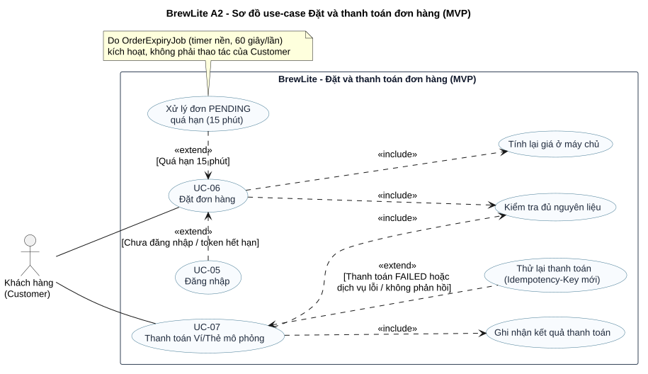

# 3.3. Task 1.3 – Đặc tả Use-Case trọng tâm: Đặt và thanh toán đơn hàng (UC-06 & UC-07)

**Dự án:** BrewLite A2 — Hệ thống đặt đồ uống tại quầy (MVP)  
**Phiên bản:** 1.0 (Dự thảo nghiệm thu Assignment 2 - Task 1.3)  
**Ngày lập:** 13/11/2026  
**Tác giả:** Nhóm kỹ thuật BrewLite A2 (Senior Software Engineer AGY)  
**Nguồn tham chiếu:** `docs/Assignment2-BrewLite.pdf` (Mục 3.3 - Task 1.3), `docs/requirements/context-and-scope.md` (Task 1.1), `docs/requirements/srs.md` (Task 1.2), mã nguồn `apps/api` và `apps/web`.

---

## 1. Thông tin chung & Phạm vi In-scope / Won't

### 1.1. Thông tin chung
Tài liệu này đặc tả chi tiết use-case nghiệp vụ trọng tâm duy nhất của Assignment 2: **Đặt và thanh toán đơn hàng**, bao gồm hai use-case thành phần liên kết chặt chẽ:
- **UC-06: Đặt đơn hàng (Create Order):** Tạo đơn hàng từ giỏ hàng đã chọn, xác thực danh tính, tính toán lại giá tại máy chủ và kiểm tra khả dụng nguyên liệu.
- **UC-07: Thanh toán Ví/Thẻ mô phỏng (Process Payment):** Khóa giao dịch đơn hàng, gọi dịch vụ thanh toán mô phỏng nội bộ (`MockPaymentService`), kiểm tra và giữ chỗ nguyên liệu nguyên tử, ghi nhận thanh toán thành công và chuyển trạng thái đơn hàng sang `PAID`.

### 1.2. Phạm vi In-scope (MVP bắt buộc tuân thủ)
- **Mô hình phục vụ:** Duy nhất 1 cửa hàng; khách nhận đồ uống **tại quầy** (Counter Pick-up); đơn vị tiền tệ **VND**; 100% không tiền mặt (Cashless).
- **Cơ chế thanh toán:** Sử dụng thành phần mô phỏng nội bộ `MockPaymentService` hỗ trợ 2 phương thức: `WALLET` (Ví điện tử mô phỏng) và `CARD` (Thẻ ngân hàng mô phỏng).
- **Tính toán giá:** Máy chủ (`PricingService`) tính lại toàn bộ đơn giá, phụ thu size, giá topping và tổng tiền dựa trên CSDL; tuyệt đối không tin tưởng giá từ client.
- **Quản lý nguyên liệu hai giai đoạn:** Kiểm tra tồn kho khả dụng khi tạo đơn (`PENDING`, chưa giữ kho); khóa bi quan (`SELECT ... FOR UPDATE`) và giữ chỗ nguyên tử (`InventoryReservation = HELD`) khi thanh toán (`PAID`).
- **An toàn giao dịch (Idempotency):** Áp dụng header `Idempotency-Key` (UUIDv4) độc lập cho cả mutation tạo đơn (`POST /api/orders`) và mutation thanh toán (`POST /api/payments`) để chống duplicate request do mạng hoặc double-click.

### 1.3. Phạm vi Won't (Tuyệt đối KHÔNG đưa vào luồng nghiệm thu Task 1.3)
Theo cam kết tại `context-and-scope.md` và `srs.md`, các tính năng sau nằm ngoài phạm vi MVP A2:
- `W-01`: Cổng thanh toán VNPAY Sandbox hoặc quyết toán tiền thật qua ngân hàng.
- `W-02`: Áp dụng mã giảm giá (voucher), tích điểm hoặc cấn trừ điểm thưởng (Loyalty Points).
- `W-03`: Nghiệp vụ quản lý kho chi tiết (nhập hàng, kiểm kê, chỉnh sửa công thức recipe).
- `W-04`: Giao hàng tận nơi (Delivery), nhập địa chỉ giao hàng hoặc quản lý chuỗi nhiều chi nhánh.
- `W-05`: Đặt món khi mất mạng (Offline ordering) và gửi thông báo đẩy (Push Notifications).
- `W-06`: Cổng quản trị (Admin Portal) riêng biệt cho chủ cửa hàng/quản lý.
- `W-07`: Khách hàng tự hủy đơn sau khi đã thanh toán hoặc luồng tự phục vụ yêu cầu hoàn tiền.

> **Ghi chú phạm vi (Scope Boundary):** Các mục `W-01`, `W-02`, `W-03` đã có trong baseline A1; trong A2 không thuộc phạm vi nghiệm thu Task 1.3; mã kế thừa A1 còn trong repo và không được coi là bằng chứng hoàn thành Task 1.3; test A2 không kiểm chứng chúng. Lý do thu hẹp: [NHÓM ĐIỀN LÝ DO].

---

## 2. Bảng tác nhân (Actors)

| Tác nhân | Vai trò trong hệ thống | Trách nhiệm trong Use-Case |
|---|---|---|
| **Khách hàng (Customer)** | **Actor chính (Primary Actor)** duy nhất của Use-Case. Đã đăng ký, xác minh OTP và đăng nhập vào ứng dụng web với vai trò `CUSTOMER`. | Duyệt giỏ hàng, xác nhận thông tin đơn, chọn phương thức thanh toán mô phỏng (`WALLET` hoặc `CARD`), bấm thanh toán, xem kết quả giao dịch và nhận mã đơn hàng để đối chiếu tại quầy. |

### Giải thích kiến trúc về Actor:
1. **MockPaymentService nằm BÊN TRONG hệ thống (Internal Component):**  
   Thành phần xử lý thanh toán mô phỏng `MockPaymentService` là một service nội bộ được backend NestJS khởi tạo cục bộ để phục vụ môi trường kiểm thử và demo đồ án MVP (`apps/api/src/payments/mock-payment.service.ts`). Nó xử lý logic đồng bộ tức thì, không giao tiếp với bên thứ ba qua Internet (như VNPAY Sandbox ở `W-01`). Vì vậy, theo nguyên tắc mô hình hóa UML, `MockPaymentService` **không được xem là External Actor**.
2. **Nhân viên quầy (Barista) chỉ xuất hiện ở HẬU ĐIỀU KIỆN:**  
   Barista là Actor nghiệp vụ của quy trình xử lý đơn tại quầy (`UC-10 Xem hàng đợi`, `UC-11 Cập nhật trạng thái`, `UC-12 Bàn giao đơn`). Khi Khách hàng hoàn tất thanh toán (đơn chuyển sang `PAID`), đơn hàng xuất hiện trong danh sách pha chế của Barista. Barista **không trực tiếp tham gia hay can thiệp vào các bước trong use-case đặt và thanh toán này**.

---

## 3. Sơ đồ Use-Case (PlantUML & Hình ảnh trực quan)

Sơ đồ thể hiện ranh giới hệ thống, tác nhân Customer, hai use-case trọng tâm `UC-06`, `UC-07`, cùng các quan hệ `<<include>>` và `<<extend>>`.

- **Tệp nguồn PlantUML:** [`docs/diagrams/use-case-checkout.puml`](../diagrams/use-case-checkout.puml)

### Quan hệ giữa các Use-Case:
- **`UC-06 Đặt đơn hàng` bao gồm (`<<include>>`):**
  - `Tính lại giá ở máy chủ`: Đảm bảo giá chuẩn từ DB, chống gian lận client (`FR-16`).
  - `Kiểm tra đủ nguyên liệu`: Kiểm tra recipe và lượng tồn khả dụng lần 1 (`FR-17`).
- **`UC-07 Thanh toán Ví/Thẻ mô phỏng` bao gồm (`<<include>>`):**
  - `Kiểm tra đủ nguyên liệu`: Khóa đơn và kiểm tra lại tồn kho lần 2, thực hiện giữ chỗ (`FR-17`, `FR-22`).
  - `Ghi nhận kết quả thanh toán`: Lưu giao dịch thanh toán thành công/thất bại (`FR-20`).
- **Các quan hệ mở rộng (`<<extend>>`):**
  - `UC-05 Đăng nhập` extends `UC-06`: Kích hoạt khi khách hàng chưa đăng nhập hoặc phiên làm việc hết hạn (`FR-12`).
  - `Thử lại thanh toán` extends `UC-07`: Kích hoạt khi thanh toán thất bại (`mockResult = FAILED`) hoặc dịch vụ thanh toán lỗi/không phản hồi (`EX-14`), cho phép khách chọn phương thức khác và gửi lại với Idempotency-Key mới (`FR-20`).
  - `Xử lý đơn PENDING quá hạn` extends `UC-06`: Tiến trình nền tự động chuyển đơn sang `CANCELLED` sau 15 phút chưa thanh toán (`FR-30`).

---

## 4. Trigger, Tiền điều kiện và Hậu điều kiện

### 4.1. Kích hoạt (Trigger)
Khách hàng bấm nút **"Thanh toán"** hoặc **"Tiến hành đặt hàng"** từ màn hình Giỏ hàng (`UC-03`) khi trong giỏ đã có từ 1 đến 30 dòng sản phẩm hợp lệ.

### 4.2. Tiền điều kiện (Preconditions)
1. **Xác thực danh tính:** Khi gửi các request tạo đơn và thanh toán, khách hàng phải có phiên đăng nhập hợp lệ với vai trò `CUSTOMER` và đính kèm JWT Token còn hạn trong request header (`FR-12`, `FR-13`). Nếu chưa đăng nhập hoặc token hết hạn, Use-Case `UC-05 Đăng nhập` được kích hoạt (xem `EX-01`); đăng nhập thất bại thì không có đơn hàng nào được tạo, đăng nhập thành công thì khách quay lại bước đang dở.
2. **Dữ liệu giỏ hàng hợp lệ:** Giỏ hàng có từ 1 đến 30 dòng món; mỗi dòng chọn đúng 1 size (S/M/L), số lượng từ 1 đến 20 ly, tối đa 3 topping không trùng lặp (`FR-05`, `FR-07`, `FR-09`, `BR-01`).
3. **Món đang kinh doanh:** Toàn bộ sản phẩm trong giỏ đều ở trạng thái đang mở bán (`isActive = true`) trong CSDL (`FR-01`).
4. **Kết nối mạng khả dụng:** Ứng dụng client duy trì kết nối Internet tới máy chủ API (`NFR-06`, `NFR-15`).

### 4.3. Hậu điều kiện (Postconditions)
#### a) Hậu điều kiện thành công (Success End Condition):
1. **Đơn hàng:** Bản ghi `Order` được tạo với mã duy nhất `#id`, liên kết đúng `userId`, tổng tiền chuẩn xác từ máy chủ và trạng thái chuyển sang **`PAID`** (`FR-15`, `FR-20`).
2. **Giữ chỗ nguyên liệu:** Số lượng nguyên liệu tương ứng với công thức của các món được giữ chỗ thành công (`InventoryReservation` có trạng thái `HELD`), tồn kho khả dụng giảm tương ứng, không có tồn âm (`FR-17`, `FR-22`).
3. **Giao dịch thanh toán:** Bản ghi `Payment` được tạo với trạng thái `SUCCESS`, phương thức `WALLET` hoặc `CARD`, lưu vết mã giao dịch và `idempotencyKey` (`FR-20`, `FR-21`).
4. **Hàng đợi quầy:** Đơn hàng xuất hiện ngay lập tức trong danh sách chờ pha chế của nhân viên quầy (`active queue`, `GET /api/orders/active`) (`FR-27`).
5. **Giao diện khách hàng:** Giỏ hàng được làm rỗng; màn hình hiển thị trang Xác nhận đơn hàng (#id, chi tiết món, tổng tiền, phương thức thanh toán) và hướng dẫn nhận món tại quầy (`FR-23`).

#### b) Hậu điều kiện thất bại (Failure End Condition):
1. **Thanh toán thất bại:** `Payment` ghi nhận trạng thái `FAILED`, `Order` chuyển sang `PAYMENT_FAILED` (HTTP `402 Payment Required`), không có nguyên liệu nào bị giữ chỗ, giỏ hàng giữ nguyên; giao diện hiển thị thông báo lỗi và nút "Thử lại thanh toán" (`FR-20`).
2. **Thiếu nguyên liệu / Tranh chấp kho:**
   - **Lúc tạo đơn (`POST /api/orders`):** Hệ thống từ chối tạo đơn với HTTP `409 Conflict` (mã lỗi `INSUFFICIENT_INGREDIENTS`), không sinh bản ghi `Order`, giỏ hàng giữ nguyên (`FR-17`).
   - **Lúc thanh toán (`POST /api/payments`):** Hệ thống từ chối thanh toán với HTTP `402 Payment Required` (kết quả `PAYMENT_FAILED`), ghi nhận `Payment = FAILED`, chuyển trạng thái `Order = PAYMENT_FAILED`, `failureReason` chứa `INSUFFICIENT_INGREDIENTS`, không giữ chỗ nguyên liệu, giỏ hàng giữ nguyên (`FR-17`, `FR-22`).

---

## 5. Bảng luồng chính (Main Flow: 1..9)

Luồng chuẩn khi Khách hàng thực hiện đặt món và thanh toán thành công bằng phương thức mô phỏng:

| Bước | Actor | Hành động (Action) | Phản hồi của Hệ thống (System Response) | FR / NFR liên quan |
|:---:|:---:|---|---|---|
| **1** | Customer | Tại màn hình Giỏ hàng (`UC-03`), khách kiểm tra các món đã chọn và bấm nút **"Tiến hành đặt hàng"**. | Kiểm tra trạng thái xác thực. Nếu token hợp lệ, chuyển hướng sang trang Checkout. Gửi yêu cầu `GET /api/auth/me` để xác nhận phiên. | `FR-12`, `FR-13` |
| **2** | System | — | Hiển thị màn hình Checkout gồm: danh sách món, size, topping, số lượng, tạm tính, và danh sách phương thức thanh toán mô phỏng khả dụng: **Ví mô phỏng (WALLET)** và **Thẻ mô phỏng (CARD)**. | `FR-19`, `NFR-07` |
| **3** | Customer | Chọn phương thức thanh toán **Ví mô phỏng (WALLET)** (hoặc CARD) và bấm nút **"Xác nhận đặt hàng & Thanh toán"**. | Khóa nút thanh toán, hiển thị trạng thái xử lý (loading spinner) để ngăn double-click từ phía người dùng. | `FR-19`, `NFR-07` |
| **4** | Customer (Web Client) | Client tự động sinh chuỗi `Idempotency-Key` (UUIDv4) cho mutation tạo đơn và gửi request `POST /api/orders` kèm payload giỏ hàng. | Nhận request kèm header `Idempotency-Key`, payload danh sách dòng món `{ items: [...] }`. | `FR-15`, `FR-18` |
| **5** | System (Backend) | `OrdersService` thực thi xử lý nghiệp vụ tạo đơn: | 1. Bỏ qua toàn bộ giá client; truy vấn DB tính lại đơn giá, phụ thu size, topping và tổng tiền. 2. Kiểm tra tồn kho nguyên liệu lần 1 theo recipe. 3. Tạo bản ghi `Order` với trạng thái **`PENDING`** (chưa giữ kho) và lưu idempotency key. 4. Trả về HTTP `201 Created` kèm thông tin đơn và mã `id`. | `FR-15`, `FR-16`, `FR-17`, `FR-18`, `NFR-02` |
| **6** | Customer (Web Client) | Nhận thông tin đơn `PENDING` (mã `#id`), client sinh `Idempotency-Key` mới (UUIDv4) cho mutation thanh toán và gửi request `POST /api/payments`. | Nhận request thanh toán kèm header `Idempotency-Key`, payload `{ orderId: id, method: "WALLET", mockResult: "SUCCESS" }`. | `FR-19`, `FR-21` |
| **7** | System (Backend) | `PaymentsService` xử lý thanh toán theo **ba pha**, gồm hai Database Transaction riêng biệt, không giữ khóa DB trong lúc gọi dịch vụ thanh toán: | **Pha A – Giành quyền thanh toán (Transaction 1):** 1. Khóa dòng đơn hàng `SELECT ... FOR UPDATE`. 2. Xác minh đơn thuộc khách hàng và đang `PENDING` / `PAYMENT_FAILED`; nếu đã có `Payment` đang `PROCESSING` thì từ chối (`PAYMENT_IN_PROGRESS`). 3. Tạo `Payment` trạng thái `PROCESSING` kèm `idempotencyKey`, rồi Commit. **Pha B – Gọi dịch vụ thanh toán (ngoài transaction):** 4. Gọi `MockPaymentService.charge()`. Nếu dịch vụ ném lỗi hoặc không phản hồi, kết quả được coi là thất bại (`EX-14`). **Pha C – Chốt kết quả (Transaction 2):** 5. Khóa lại dòng đơn hàng. Nếu thanh toán thành công thì kiểm tra tồn kho lần 2 và giữ chỗ nguyên liệu (`InventoryReservation = HELD`). 6. Thành công: `Payment = SUCCESS`, `Order = PAID`. Thiếu nguyên liệu hoặc thanh toán thất bại: `Payment = FAILED`, `Order = PAYMENT_FAILED`, không giữ kho. 7. Commit transaction. | `FR-17`, `FR-20`, `FR-21`, `FR-22`, `NFR-05` |
| **8** | System (Backend) | — | Trả về HTTP `201 Created` kèm đối tượng `Payment` thành công và `Order` đã ở trạng thái `PAID`. Đơn hàng tự động hiển thị trong hàng đợi quầy (`active queue`). | `FR-20`, `FR-27`, `NFR-02` |
| **9** | Customer (Web Client) | — | Xóa các món đã thanh toán khỏi giỏ hàng local (`cart store`); chuyển hướng sang màn hình Xác nhận đơn hàng (`/checkout/success` hoặc trạng thái hoàn tất), hiển thị mã đơn `#id`, chi tiết món, tổng tiền đã trả và hướng dẫn nhận hàng tại quầy. | `FR-23`, `G-01`, `G-02` |

---

## 6. Luồng thay thế (AF) và Luồng ngoại lệ (EX)

### 6.1. Bảng Luồng thay thế (Alternate Flows)

| Mã luồng | Tên luồng thay thế | Điểm rẽ nhánh | Mô tả chi tiết | Kết quả |
|---|---|:---:|---|---|
| **AF-01** | Thanh toán qua Thẻ mô phỏng (CARD) | Bước 3 | Khách hàng chọn phương thức `CARD` thay vì `WALLET`. Tại Bước 6, client gửi `{ orderId, method: "CARD", mockResult: "SUCCESS" }`. Backend xử lý và ghi nhận `Payment.method = CARD`. | Đơn hàng `PAID`, giao dịch thành công. |
| **AF-02** | Thử lại thanh toán sau khi thất bại | Sau EX-09 | Sau khi giao dịch trước bị `PAYMENT_FAILED`, khách hàng chọn lại phương thức thanh toán tại trang Checkout và bấm nút "Thử lại thanh toán". Client sinh `Idempotency-Key` mới và gọi `POST /api/payments` cho cùng `orderId`. | Đơn chuyển từ `PAYMENT_FAILED` sang `PAID`. |
| **AF-03** | Thanh toán đơn hàng PENDING từ Lịch sử đơn hàng | Khởi đầu từ /orders | Khách hàng mở trang Lịch sử đơn (`UC-08`), thấy đơn cũ ở trạng thái `PENDING` (còn hạn 15 phút), bấm "Thanh toán tiếp". Hệ thống tải lại đơn qua URL `?orderId=...`, bỏ qua bước tạo đơn (Bước 4, 5) và tiến hành thanh toán trực tiếp từ Bước 6. | Đơn `PENDING` được thanh toán thành công sang `PAID`. |

### 6.2. Bảng Luồng ngoại lệ (Exception Flows: EX-01 .. EX-13)

| Mã luồng | Tình huống ngoại lệ | Điểm phát sinh | Cơ chế phát hiện & Phản hồi hệ thống | Mã lỗi / Trạng thái |
|---|---|:---:|---|---|
| **EX-01** | Chưa đăng nhập, token hết hạn hoặc sai quyền | Bước 1, 4, 6 | Client/Backend kiểm tra JWT token. Nếu thiếu token hoặc token hết hạn, trả về `401 Unauthorized`. Nếu dùng tài khoản vai trò khác `CUSTOMER` (hoặc truy cập đơn người khác), trả về `403 Forbidden`. Chuyển hướng khách sang màn hình Đăng nhập (`UC-05`). | `401 Unauthorized` `403 Forbidden` (`FR-12`, `FR-13`, `NFR-03`) |
| **EX-02** | Giỏ hàng rỗng hoặc payload sai cấu trúc | Bước 4 | Backend kiểm tra dữ liệu payload: danh sách items rỗng, số lượng <= 0 hoặc > 20, size không thuộc S/M/L, hoặc > 3 topping. Hệ thống từ chối tạo đơn. | `400 Bad Request` (`FR-05`, `FR-15`) |
| **EX-03** | Món bị ngừng bán trong lúc đặt | Bước 5 | Khi truy vấn DB, backend phát hiện món có `isActive = false` hoặc không tồn tại. Hệ thống từ chối tạo đơn và thông báo tên món đã ngừng bán để khách bỏ khỏi giỏ. | `400 Bad Request` / `404 Not Found` (`FR-01`, `FR-15`) |
| **EX-04** | Thiếu nguyên liệu khi tạo đơn | Bước 5 | `InventoryService` kiểm tra recipe món, phát hiện nguyên liệu tồn khả dụng không đủ cho số lượng yêu cầu. Backend từ chối tạo đơn, KHÔNG sinh bản ghi `Order`. | `409 Conflict` `INSUFFICIENT_INGREDIENTS` (`FR-17`) |
| **EX-05** | Thiếu nguyên liệu lúc thanh toán | Bước 7 | Tranh chấp nguyên liệu xảy ra giữa lúc tạo đơn và thanh toán. Khi kiểm tra tồn kho lần 2 trong transaction, nguyên liệu đã bị đơn khác giữ hết. Hệ thống ghi nhận `Payment = FAILED`, chuyển `Order = PAYMENT_FAILED`, không giữ kho. | `402 Payment Required` `PAYMENT_FAILED (failureReason: INSUFFICIENT_INGREDIENTS)` (`FR-17`, `FR-22`) |
| **EX-06** | Giá client bị can thiệp sửa đổi | Bước 5 | Khách hàng can thiệp devtools sửa giá trên client. Backend hoàn toàn bỏ qua giá client gửi, tính lại tổng tiền từ CSDL. Đơn được tạo với giá chuẩn. Nếu tổng tiền khác biệt so với client hiển thị, client yêu cầu khách xác nhận lại. | Giá CSDL chuẩn (`FR-16`) |
| **EX-07** | Gửi lại cùng Idempotency-Key và cùng payload | Bước 4, 6 | Do mất mạng tạm thời hoặc client gửi lặp. Backend phát hiện key đã được xử lý thành công với cùng SHA-256 hash payload. Hệ thống bỏ qua bước ghi DB mới, trả về kết quả cũ kèm header `Idempotent-Replayed: true`. | HTTP `200/201` `Idempotent-Replayed: true` (`FR-18`, `FR-21`, `NFR-05`) |
| **EX-08** | Tái sử dụng Idempotency-Key cho payload khác | Bước 4, 6 | Client dùng lại key cũ nhưng gửi nội dung dòng món hoặc số tiền khác. Backend phát hiện hash payload không khớp với bản ghi đã lưu, lập tức từ chối yêu cầu. | `409 Conflict` `IDEMPOTENCY_KEY_REUSED` (`FR-18`, `FR-21`, `NFR-05`) |
| **EX-09** | Thanh toán mô phỏng thất bại | Bước 7 | `MockPaymentService` trả kết quả `FAILED` (hoặc gửi payload `mockResult = "FAILED"`). `PaymentsService` ghi `Payment = FAILED`, chuyển `Order = PAYMENT_FAILED`, không giữ kho. Giao diện hiển thị lý do lỗi và nút thử lại (`AF-02`). | `402 Payment Required` `Order: PAYMENT_FAILED` (`FR-20`) |
| **EX-10** | Tranh chấp nguyên liệu đồng thời | Bước 7 | 10 khách hàng cùng thanh toán đơn chứa nguyên liệu của 5 ly cuối cùng. Khóa `SELECT ... FOR UPDATE` sắp xếp tuần tự: 5 đơn đến trước được giữ kho và `PAID`, 5 đơn đến sau bị từ chối do hết kho khả dụng khi giữ kho. Không có hiện tượng trừ âm kho. | `402 Payment Required` `PAYMENT_FAILED (5 đơn sau)` (`FR-22`, `NFR-05`) |
| **EX-11** | Đơn PENDING quá hạn 15 phút chưa thanh toán | Bất kỳ lúc nào | Tiến trình nền `OrderExpiryJob` quét các đơn `PENDING` có `createdAt` quá 15 phút và tự động chuyển trạng thái sang `CANCELLED`. Nếu khách bấm thanh toán sau thời điểm này, backend từ chối xử lý. | `409 Conflict` `INVALID_TRANSITION (message: Không thể thanh toán đơn hàng đang ở trạng thái CANCELLED)` (`FR-30`) |
| **EX-12** | Mất kết nối mạng / lỗi server 5xx | Bước 4, 6 | Khách hàng rớt mạng hoặc máy chủ quá tải trả 5xx. Giao diện hiển thị cảnh báo mất mạng và nút thử lại. Nhờ cơ chế `Idempotency-Key` được lưu tại session storage, khách bấm thử lại an toàn tuyệt đối mà không sợ tạo đơn hay tính tiền hai lần. | Client Retry banner (`NFR-11`, `NFR-15`) |
| **EX-13** | Tắt chế độ thanh toán mô phỏng | Bước 6, 7 | Biến môi trường hệ thống cấu hình `PAYMENT_MOCK_ENABLED=false` (hoặc `NODE_ENV=production` mà biến này khác "true") trong khi phương thức là `WALLET`/`CARD`. Backend từ chối xử lý và thông báo phương thức thanh toán mô phỏng không khả dụng. | `400 Bad Request` `PAYMENT_METHOD_NOT_SUPPORTED` (`NFR-11`) |
| **EX-14** | Dịch vụ thanh toán mô phỏng lỗi hoặc không phản hồi | Bước 7 (Pha B) | `MockPaymentService.charge()` ném lỗi. Backend không để request treo: coi kết quả là thất bại, chốt `Payment = FAILED`, `Order = PAYMENT_FAILED` ở Pha C. Vì đây là thanh toán mô phỏng, không có tiền thật được ghi nhận nên không cần hoàn tiền hay bù trừ; khách thử lại với Idempotency-Key mới. | `402 Payment Required` `PAYMENT_FAILED (Cổng thanh toán không phản hồi, vui lòng thử lại)` (`FR-20`, `NFR-11`) |
| **EX-15** | Gửi thanh toán khi đơn đang có giao dịch `PROCESSING` | Bước 6, 7 | Khách bấm thanh toán lần nữa bằng Idempotency-Key khác (hoặc request thứ hai đến khi request đầu chưa chốt). Backend không tạo `Payment` thứ hai; với cùng key thì chờ tối đa khoảng 3 giây để trả lại kết quả đã chốt. Nếu vẫn chưa chốt thì trả lỗi để khách thử lại sau. | `409 Conflict` `PAYMENT_IN_PROGRESS` (`FR-21`) |

---

## 7. Quy tắc nghiệp vụ (Business Rules: BR-01 .. BR-06)

### BR-01: Giới hạn cấu hình dòng đơn hàng (Cart Constraints)
- Mỗi đơn hàng phải chứa tối thiểu **1 dòng** và tối đa **30 dòng món**.
- Mỗi dòng món có số lượng từ **1 đến 20 ly**.
- Mỗi dòng món bắt buộc chọn đúng **1 kích cỡ** hợp lệ (`S`, `M`, hoặc `L`).
- Mỗi ly được chọn tối đa **3 topping** không trùng lặp và phải nằm trong danh mục topping được phép của sản phẩm đó (`FR-05`, `FR-15`).

### BR-02: Bất biến tính giá tại máy chủ (Server-Side Pricing Invariant)
- Máy chủ chịu trách nhiệm duy nhất trong việc xác định đơn giá sản phẩm, phụ thu kích cỡ (Size S/M/L) và đơn giá topping.
- Mọi giá tiền client gửi lên đều bị bỏ qua hoàn toàn.
- Công thức tính tiền tại máy chủ:
  $$\text{LineTotal} = \left(\text{BasePrice} + \text{SizeAdjustment} + \sum \text{ToppingPrice}\right) \times \text{Quantity}$$
  $$\text{OrderTotal} = \sum \text{LineTotal}$$
- Mọi đơn vị tính đều quy đổi theo đồng Việt Nam (**VND**) và không làm tròn lẻ dưới 1 VND (`FR-16`).

### BR-03: Kiểm tra và giữ chỗ tồn kho hai giai đoạn (Two-Phase Inventory Rule)
- **Giai đoạn 1 (Lúc tạo đơn - `POST /api/orders`):** Hệ thống chỉ kiểm tra (`read-only check`) xem tổng lượng nguyên liệu yêu cầu có vượt quá tồn kho khả dụng hiện tại không. **Không thực hiện giữ chỗ kho** ở bước này; đơn hàng lưu ở trạng thái `PENDING`.
- **Giai đoạn 2 (Lúc thanh toán - `POST /api/payments`):** Hệ thống khóa dòng đơn hàng `SELECT ... FOR UPDATE`, kiểm tra lại tồn kho khả dụng lần 2. Nếu đủ, thực hiện giữ chỗ nguyên tử (`InventoryReservation = HELD`) đồng thời với việc tạo `Payment = SUCCESS` và đổi `Order = PAID`. Nếu thiếu, từ chối thanh toán và chuyển `Order = PAYMENT_FAILED` (`FR-17`, `FR-22`).

### BR-04: Quy tắc an toàn Idempotency cho Mutations (Mutation Idempotency Rule)
- Client (Next.js) luôn sinh `Idempotency-Key` dạng UUIDv4 cho mỗi mutation tạo đơn (`POST /api/orders`) và thanh toán (`POST /api/payments`).
- Phía Backend hiện chỉ kiểm tra độ dài, không bắt buộc định dạng UUIDv4: tạo đơn chấp nhận khóa từ 1 đến 128 ký tự và cho phép bỏ qua header (khi đó không có bảo vệ chống trùng); thanh toán bắt buộc có khóa (qua header hoặc body), nếu thiếu trả `400 IDEMPOTENCY_KEY_REQUIRED`.
- Bản ghi idempotency lưu trữ bộ ba: `(userId, idempotencyKey, requestHash)`.
- **Replay:** Gửi lại cùng key + cùng request hash $\rightarrow$ Trả về kết quả cũ đã lưu, kèm header `Idempotent-Replayed: true`.
- **Conflict:** Gửi lại cùng key + khác request hash $\rightarrow$ Từ chối ngay lập tức với HTTP `409 Conflict` (`ORDER_IDEMPOTENCY_KEY_REUSED` hoặc `PAYMENT_IDEMPOTENCY_KEY_REUSED`) (`FR-18`, `FR-21`, `NFR-05`).
- Tính duy nhất được bảo vệ ở cả tầng cơ sở dữ liệu: `Payment.idempotencyKey` là unique, và đơn hàng có ràng buộc unique `(userId, creationKey)`, nên hai request song song cùng khóa không thể tạo bản ghi thứ hai.

### BR-05: Giới hạn thời gian hiệu lực đơn chờ thanh toán (PENDING Order Expiry)
- Đơn hàng ở trạng thái `PENDING` có thời hạn thanh toán tối đa là **15 phút (900 giây)** kể từ thời điểm tạo (`createdAt`).
- Tiến trình quét định kỳ `OrderExpiryJob` tự động cập nhật các đơn quá hạn sang trạng thái `CANCELLED`.
- Đơn hàng đã `CANCELLED` tuyệt đối không được phép thực hiện thanh toán (`FR-30`).

### BR-06: Phương thức thanh toán chấp nhận trong MVP (Accepted Payment Methods)
- Hệ thống MVP chỉ chấp nhận 2 phương thức thanh toán mô phỏng: `WALLET` (Ví điện tử mô phỏng) và `CARD` (Thẻ ngân hàng mô phỏng).
- Thanh toán chỉ mang tính mô phỏng, không có tiền thật. Tham số `mockResult` (`SUCCESS` hoặc `FAILED`) chỉ phục vụ demo và kiểm thử: nó chỉ có thể ép kết quả thất bại, còn mặc định thanh toán luôn thành công. Khi `NODE_ENV=production`, phương thức `WALLET`/`CARD` chỉ hoạt động nếu `PAYMENT_MOCK_ENABLED=true` (xem `EX-13`).
- Nếu sau này tích hợp cổng thanh toán thật thì cần bổ sung cơ chế đối soát và hoàn tiền; hạng mục này nằm ngoài phạm vi MVP (`W-07`).
- Tuyệt đối không chấp nhận tiền mặt tại quầy (Cashless 100%).
- Hệ thống không hỗ trợ cơ chế tự hoàn tiền (Self-refund) trên giao diện khách hàng (`FR-19`, `W-01`, `W-07`).

---

## 8. Tiêu chí chấp nhận (Acceptance Criteria: AC-01 .. AC-10)

Các tiêu chí được viết dưới cấu trúc **Given - When - Then** và gắn trực tiếp với mã kiểm thử tự động `TC-*`:

### AC-01: Tạo đơn hàng hợp lệ với giá do máy chủ tính toán
- **Mã test:** `TC-FR-15`, `TC-FR-16`
- **Given:** Khách hàng đã đăng nhập, giỏ hàng có 2 món (Trà sữa size M, 2 topping và Cà phê đen size L), giá client bị cố tình sửa thành 0 VND.
- **When:** Khách hàng gửi yêu cầu tạo đơn `POST /api/orders` kèm `Idempotency-Key`.
- **Then:** Đơn hàng được tạo thành công với mã `#id`, trạng thái `PENDING`, tổng tiền khớp 100% với giá tính toán từ CSDL của máy chủ (bỏ qua giá 0 VND của client).

### AC-02: Từ chối tạo đơn khi không đủ nguyên liệu khả dụng
- **Mã test:** `TC-FR-17`
- **Given:** Nguyên liệu "Trà đen" trong kho chỉ còn khả dụng 100ml, recipe yêu cầu 150ml cho 1 ly size L.
- **When:** Khách hàng gửi yêu cầu tạo đơn 1 ly size L.
- **Then:** Hệ thống từ chối tạo đơn, trả về HTTP `409 Conflict` kèm thông báo mã lỗi `INSUFFICIENT_INGREDIENTS`, không có bản ghi `Order` nào được sinh ra.

### AC-03: Chống tạo đơn trùng lặp khi gửi lại cùng Idempotency-Key
- **Mã test:** `TC-FR-18`, `TC-NFR-05`
- **Given:** Yêu cầu tạo đơn với `Idempotency-Key = "uuid-key-01"` đã tạo thành công đơn `#101`.
- **When:** Khách hàng (hoặc mạng) gửi lại cùng request với `Idempotency-Key = "uuid-key-01"` và cùng nội dung payload.
- **Then:** Hệ thống không tạo thêm đơn mới, trả về HTTP `201` (hoặc `200`) chứa thông tin đơn `#101` kèm header `Idempotent-Replayed: true`.

### AC-04: Thanh toán WALLET/CARD mô phỏng thành công
- **Mã test:** `TC-FR-19`, `TC-FR-20`
- **Given:** Đơn hàng `#102` đang ở trạng thái `PENDING`, nguyên liệu kho khả dụng đầy đủ.
- **When:** Khách hàng gửi `POST /api/payments` với `method = "WALLET"` (hoặc `"CARD"`), `mockResult = "SUCCESS"`, kèm `Idempotency-Key`.
- **Then:** Bản ghi `Payment` lưu trạng thái `SUCCESS`, nguyên liệu được chuyển sang `InventoryReservation = HELD`, trạng thái đơn hàng `#102` cập nhật thành `PAID`, phản hồi HTTP `201`.

### AC-05: Xử lý thanh toán mô phỏng thất bại và hỗ trợ thử lại
- **Mã test:** `TC-FR-20`
- **Given:** Đơn hàng `#103` đang ở trạng thái `PENDING`.
- **When:** Khách hàng gửi yêu cầu thanh toán với `mockResult = "FAILED"`.
- **Then:** Bản ghi `Payment` lưu trạng thái `FAILED`, đơn hàng chuyển sang `PAYMENT_FAILED` (HTTP `402`), không giữ kho nguyên liệu. Khách hàng bấm thử lại với `Idempotency-Key` mới và `mockResult = "SUCCESS"` thì thanh toán thành công sang `PAID`.

### AC-06: Chống thanh toán lặp với Idempotency-Key thanh toán
- **Mã test:** `TC-FR-21`, `TC-NFR-05`
- **Given:** Giao dịch thanh toán đơn `#104` với `Idempotency-Key = "pay-key-01"` đã thành công sang `PAID`.
- **When:** Gửi lại yêu cầu thanh toán từ 2 đến 5 lần với cùng `Idempotency-Key = "pay-key-01"` và cùng payload.
- **Then:** Hệ thống chỉ ghi nhận duy nhất 1 lần thanh toán thành công, 1 lần giữ kho nguyên liệu và trả về kết quả nhất quán cho mọi lần gửi lặp.

### AC-07: Nhất quán tồn kho khi nhiều yêu cầu cạnh tranh đồng thời
- **Mã test:** `TC-FR-22`, `TC-NFR-05`
- **Given:** Tồn kho nguyên liệu chỉ đủ để pha chế tối đa 5 đơn hàng. Có 10 yêu cầu thanh toán đồng thời cho 10 đơn `PENDING` khác nhau.
- **When:** 10 yêu cầu thanh toán được gửi tới hệ thống cùng một thời điểm.
- **Then:** Đúng 5 đơn hàng được thanh toán thành công và chuyển sang `PAID`; 5 đơn còn lại bị từ chối với HTTP `402 Payment Required` (`PAYMENT_FAILED` do hết kho khi giữ kho). Số lượng tồn kho không bao giờ bị âm hoặc bị giữ chỗ vượt mức.

### AC-08: Hiển thị đầy đủ thông tin xác nhận sau khi đặt và thanh toán
- **Mã test:** `TC-FR-23`
- **Given:** Khách hàng vừa thanh toán thành công đơn hàng `#105`.
- **When:** Màn hình chuyển sang trang Xác nhận đơn hàng.
- **Then:** Giao diện hiển thị rõ ràng mã đơn `#105`, danh sách các món/size/topping/số lượng, tổng tiền đã trả, phương thức thanh toán và trạng thái `Đã thanh toán (PAID)`.

### AC-09: Tự động hủy đơn hàng PENDING quá hạn 15 phút
- **Mã test:** `TC-FR-30`
- **Given:** Đơn hàng `#106` được tạo ở trạng thái `PENDING` và không được thanh toán sau 15 phút.
- **When:** Tiến trình `OrderExpiryJob` kích hoạt quét đơn quá hạn.
- **Then:** Đơn hàng `#106` tự động đổi trạng thái sang `CANCELLED`. Mọi nỗ lực thanh toán tiếp theo cho đơn này đều bị từ chối với HTTP `409 Conflict` (`INVALID_TRANSITION`: Không thể thanh toán đơn hàng đang ở trạng thái CANCELLED).

### AC-10: Hiệu năng phản hồi và khả năng chịu lỗi kết nối mạng
- **Mã test:** `TC-NFR-02`, `TC-NFR-11`, `TC-NFR-15`
- **Given:** Hệ thống vận hành với tải 20 yêu cầu đồng thời trên môi trường local/staging.
- **When:** Thực hiện các cuộc gọi `POST /api/orders` và `POST /api/payments`.
- **Then:** Thời gian phản hồi p95 $\le$ 3.0 giây. Khi ngắt mạng giữa chừng, client hiển thị trạng thái lỗi có thể hiểu được và cho phép thử lại an toàn bằng `Idempotency-Key` mà không gây sai lệch dữ liệu.

---

## 9. Ma trận liên kết yêu cầu (Traceability Matrix: 17 mã FR / NFR)

Bảng truy vết đầy đủ 17 mã yêu cầu chính thức từ `srs.md` vào các bước, quy tắc, tiêu chí của Use-Case Đặt và thanh toán đơn hàng, đối chiếu mục tiêu `G-01..G-04` và kịch bản nghiệm thu `AT-01..AT-08`:

| Mã Yêu cầu | Tên yêu cầu SRS | Mức ưu tiên | Bước Luồng chính / Ngoại lệ | Business Rule | Acceptance Criteria | Mục tiêu (`G-xx`) | Kịch bản (`AT-xx`) | Ca kiểm thử (`TC-*`) |
|:---:|---|:---:|:---:|:---:|:---:|:---:|:---:|:---:|
| **FR-12** | Đăng nhập tài khoản | Must | Bước 1, EX-01 | BR-04 | AC-01 | G-01 | AT-01, AT-02 | TC-FR-12 |
| **FR-13** | Phân quyền truy cập đơn hàng | Must | Bước 1, Bước 7, EX-01 | BR-04 | AC-01 | G-01 | AT-02 | TC-FR-13 |
| **FR-15** | Tạo đơn hàng từ giỏ | Must | Bước 4, Bước 5, EX-02 | BR-01 | AC-01 | G-01, G-02 | AT-01 | TC-FR-15 |
| **FR-16** | Tính lại giá tại máy chủ | Must | Bước 5, EX-06 | BR-02 | AC-01 | G-02 | AT-06 | TC-FR-16 |
| **FR-17** | Kiểm tra khả dụng nguyên liệu | Must | Bước 5, Bước 7, EX-04, EX-05 | BR-03 | AC-02, AC-07 | G-03 | AT-03 | TC-FR-17 |
| **FR-18** | Chống tạo đơn trùng khi gửi lại | Must | Bước 4, Bước 5, EX-07, EX-08 | BR-04 | AC-03 | G-03 | AT-04 | TC-FR-18 |
| **FR-19** | Chọn Ví/Thẻ mô phỏng | Must | Bước 2, Bước 3, Bước 6, AF-01 | BR-06 | AC-04 | G-01 | AT-01 | TC-FR-19 |
| **FR-20** | Ghi nhận thanh toán thành công/thất bại | Must | Bước 7, Bước 8, AF-02, EX-09 | BR-03 | AC-04, AC-05 | G-03 | AT-01, AT-05 | TC-FR-20 |
| **FR-21** | Chống thanh toán lặp | Must | Bước 6, Bước 7, EX-07, EX-08 | BR-04 | AC-06 | G-03 | AT-04 | TC-FR-21 |
| **FR-22** | Nhất quán tồn kho khi đặt đồng thời | Must | Bước 7, EX-05, EX-10 | BR-03 | AC-07 | G-03 | AT-03 | TC-FR-22 |
| **FR-23** | Xác nhận sau khi đặt và thanh toán | Must | Bước 9 | BR-01 | AC-08 | G-02 | AT-01 | TC-FR-23 |
| **FR-30** | Xử lý đơn chờ quá hạn | Should | EX-11 | BR-05 | AC-09 | G-03 | AT-04 | TC-FR-30 |
| **NFR-02** | Hiệu năng đặt và thanh toán (p95 $\le$ 3s) | Must | Bước 5, Bước 7, Bước 8 | — | AC-10 | G-01 | AT-01 | TC-NFR-02 |
| **NFR-03** | Bảo mật xác thực và phân quyền | Must | Bước 1, Bước 5, Bước 7, EX-01 | — | AC-01 | G-01 | AT-02 | TC-NFR-03 |
| **NFR-05** | Toàn vẹn giao dịch và dữ liệu | Must | Bước 5, Bước 7, EX-07, EX-10 | BR-03, BR-04 | AC-03, AC-06, AC-07 | G-03 | AT-03, AT-04 | TC-NFR-05 |
| **NFR-11** | Giám sát và xử lý lỗi rõ ràng | Must | Bước 8, EX-02..EX-13 | — | AC-10 | G-01 | AT-07, AT-08 | TC-NFR-11 |
| **NFR-15** | Xử lý mất kết nối mạng an toàn | Should | EX-12 | BR-04 | AC-10 | G-01 | AT-04, AT-07 | TC-NFR-15 |

---

## 10. Ghi nhận thực trạng mã nguồn & Điểm cần nhóm xác nhận

### 10.1. Ghi nhận thực trạng mã nguồn kế thừa (Code Audit Findings)
Qua quá trình kiểm tra chi tiết các file nguồn tại `apps/api` và `apps/web`:
1. **Backend (`apps/api`):**
   - Đã cài đặt hoàn chỉnh `OrdersService`, `PricingService`, `InventoryService` và `PaymentsService`.
   - Đã hỗ trợ đầy đủ `Idempotency-Key` cho cả `POST /api/orders` và `POST /api/payments` (`FR-18`, `FR-21`).
   - `MockPaymentService` đã hỗ trợ nhánh xử lý cho cả 2 phương thức `WALLET` và `CARD` với cờ `mockResult = "SUCCESS" | "FAILED"` (`FR-19`, `FR-20`).
   - Đã có cơ chế khóa dòng đơn hàng `FOR UPDATE` và kiểm tra kho hai giai đoạn (`FR-17`, `FR-22`).
   - Đã có `OrderExpiryJob` định kỳ quét đơn quá hạn 15 phút (`FR-30`).
2. **Frontend (`apps/web`):**
   - `apps/web/src/lib/checkout-flow.ts` đã xây dựng cấu trúc `CheckoutFlow` có lưu trữ session storage, tự động sinh và gửi `Idempotency-Key` khi gọi API.
   - **Độ lệch giao diện Checkout (`apps/web/src/app/(shop)/checkout/page.tsx`):** Giao diện hiện tại đang render cứng radio button cho `VNPAY` và phần tích điểm loyalty; chưa có nút lựa chọn trực quan cho `WALLET` (Ví mô phỏng) và `CARD` (Thẻ mô phỏng) theo đặc tả `FR-19`.

### 10.2. Phạm vi điều chỉnh kỹ thuật (Scope Boundary)
- **Quy tắc Assignment 2:** Giai đoạn Task 1 là đặc tả yêu cầu (Requirements Specification). Do đó, nhánh `a2/task-1.3-use-case-checkout` tập trung hoàn thiện bộ tài liệu chuẩn chỉnh, sơ đồ UML và ma trận truy vết.
- **Kế hoạch triển khai:** Hạng mục bổ sung radio button chọn `WALLET` / `CARD` trên giao diện `checkout/page.tsx` và tinh chỉnh đồng bộ Idempotency client được ghi nhận chính thức vào backlog kỹ thuật để thực hiện trong **Sprint 2 (Task 5.1 - Hoàn thiện giao diện và luồng E2E)**, đảm bảo không phá vỡ tính tuần tự của đồ án và không chạm vào các phạm vi Won't (`W-01`, `W-02`).

### 10.3. Các điểm cần nhóm xác nhận trước nghiệm thu (Sign-off Items)
1. **Thời gian hết hạn đơn PENDING:** Nhóm kỹ thuật thống nhất chọn mốc **15 phút (900 giây)** theo cài đặt hiện tại của `OrderExpiryJob` (thay vì 10 hay 30 phút).
2. **Tần suất cron job hủy đơn:** Tiến trình nền quét đơn quá hạn chạy mỗi 1 phút một lần (`setInterval` 60.000 ms trong `OrderExpiryJob`, không chạy khi `NODE_ENV=test`).
3. **Ngưỡng đo hiệu năng NFR-02:** Ngưỡng p95 $\le$ 3.0 giây được áp dụng khi chạy bộ test tải 20 CCU trên môi trường demo local/staging.

### 10.4. Giới hạn đã biết của mã nguồn hiện tại
- **Payment `WALLET`/`CARD` bị kẹt ở `PROCESSING`:** nếu backend dừng đột ngột sau Pha A (đã tạo `Payment = PROCESSING`) và trước Pha C, mã nguồn đã đối chiếu không có cơ chế tự phục hồi cho thanh toán mô phỏng (việc đối soát chỉ có cho VNPAY, ngoài phạm vi). Hậu quả: thanh toán lại trả `409 PAYMENT_IN_PROGRESS`, hủy đơn trả `409 PAYMENT_IN_PROGRESS`, và `OrderExpiryJob` bỏ qua đơn đó. Đề xuất cho giai đoạn cài đặt: đặt thời hạn cho `Payment PROCESSING` của thanh toán mô phỏng rồi chuyển sang `FAILED`. Đây là việc sửa mã nguồn, không thuộc Task 1.3.
